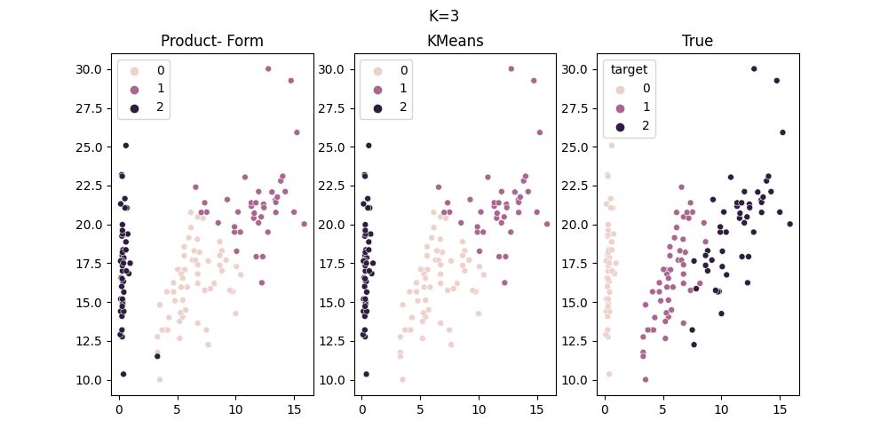
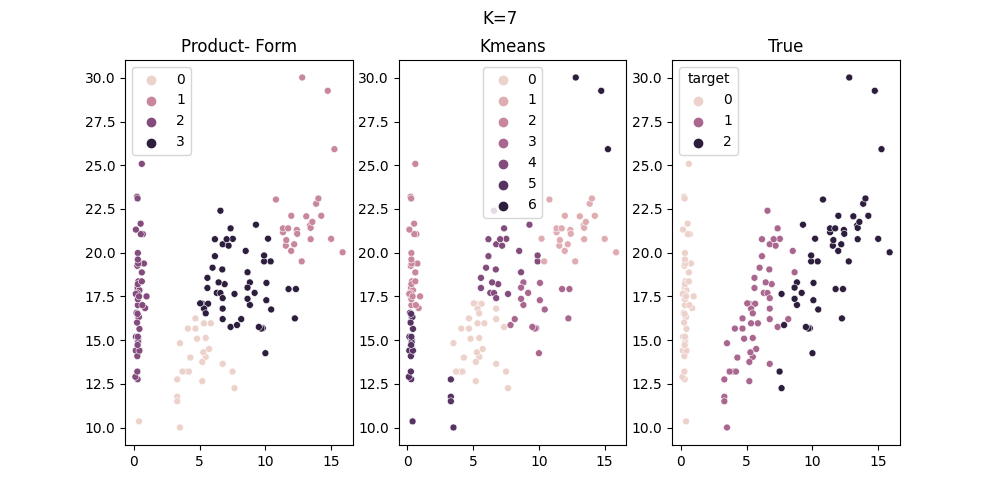
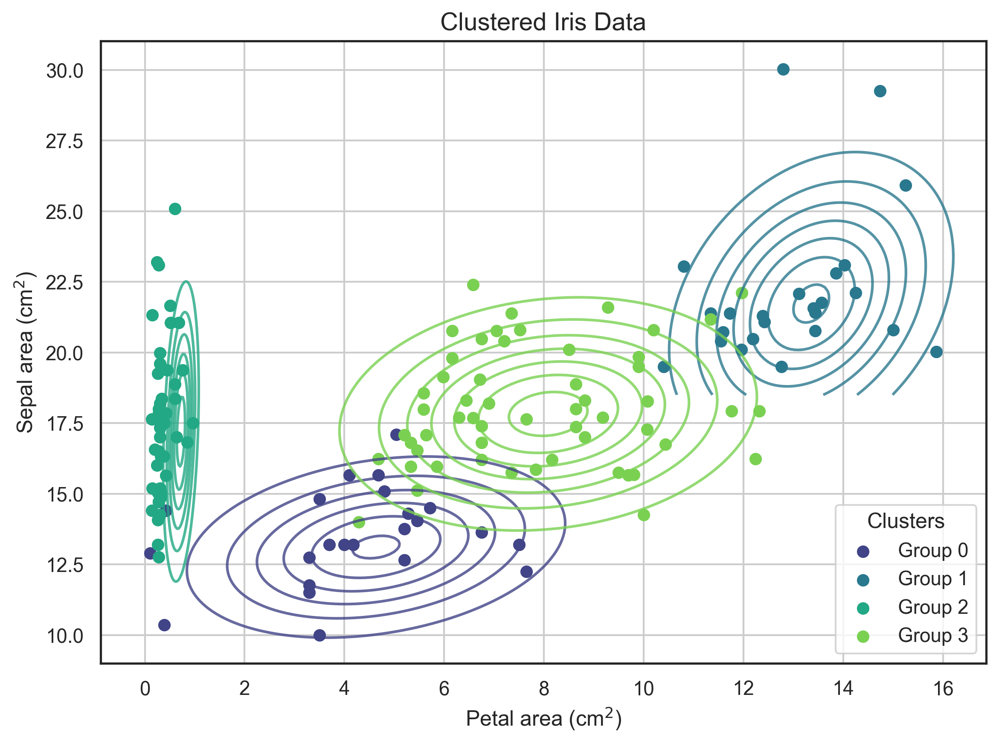

# bayesiancl

[](https://opensource.org/licenses/MIT)
[](https://www.python.org/)
[](#project-status)

**Bayesian clustering without fixing the number of clusters.** `bayesiancl` partitions data with Bayesian inference: you give an upper bound $k$ on the number of clusters, and the method finds the most probable partition of the data, which may use fewer clusters.

It implements two methods, built on projection theory, that differ in the prior they place on partitions:

| Method | Class | Prior on partitions |
| :--- | :--- | :--- |
| **ProdForm** | `ProductForm` | Product form: a product of point-level priors. |
| **CardBased** | `CardBased` | Depends on the partition's cardinality array (the sizes of its clusters). |

---

## Contents

- [How it works](#how-it-works)
- [Installation](#installation)
- [Quickstart](#quickstart)
- [API overview](#api-overview)
- [Results](#results)
- [Repository structure](#repository-structure)
- [Author and credits](#author-and-credits)
- [License](#license)

---

## How it works

- Each cluster is assumed to be normally distributed around an unknown "true" mean.
- You supply **prior means**, one per possible cluster. Their number sets the upper bound $k$. For example, they can be K-Means centres.
- The model combines these priors with the data to compute posterior probabilities over partitions, then returns the **maximum a posteriori (MAP) partition**.
- 1-D and 2-D data are supported.

The full theory (derivations, assumptions and proofs) is in the [thesis](docs/Bayesian_Clustering_MSc.pdf).

---

## Installation

Requires Python 3.10+ and [Git](https://git-scm.com/).

```bash
git clone https://github.com/Australeza/bayesiancl.git
cd bayesiancl
pip install -r requirements.txt   # dependencies
pip install -e .                  # the package itself
```

Optional, for development (linting and pre-commit hooks):

```bash
pip install -r requirements_dev.txt
```

> [!NOTE]
> The package is imported as `bayesian_clustering`, even though the repository is called `bayesiancl`.

---

## Quickstart

```python
import numpy as np
from bayesian_clustering import ProductForm

# 1-D toy data: three groups around 1, 4.5 and 10
X = np.array([1.2, 1.4, 4.5, 4.6, 10.0, 11.0])

# One prior mean per possible cluster -> upper bound k = 3
prior_means = np.array([1.0, 5.0, 10.0])

model = ProductForm(sampling_size=300)
model.fit(X, prior_means=prior_means)
labels, partition = model.predict(X)

print(labels)     # [0, 0, 1, 1, 2, 2]  cluster label per point
print(partition)  # [[1, 2], [3, 4], [5, 6]]  points per cluster (1-indexed)
```

`CardBased` follows the same `fit` / `predict` pattern.

For a full worked example on the Iris dataset, with K-Means centres as priors, see [`notebooks/example-iris.py`](notebooks/example-iris.py). It is a Jupytext script that can be opened as a notebook.

---

## API overview

Both classes share the same interface:

| Method | Description |
| :--- | :--- |
| `fit(data, prior_means)` | Computes the marginals and posterior quantities. `prior_means` has shape `(k,)` for 1-D data or `(k, 2)` for 2-D data. |
| `predict(data)` | Returns the MAP partition. |
| `fit_predict(data, prior_means)` | Runs `fit` and then `predict`. |
| `assumptions_partition_prior_check()` | Checks that the partition-prior assumptions hold. |

Main constructor options:

| Parameter | Default | Meaning |
| :--- | :--- | :--- |
| `use_partition_space` | `False` | If `True`, enumerates **every** partition to find the exact MAP. This is only feasible for small datasets, because the number of partitions grows very fast. |
| `sampling_size` | `None` | If set, the method samples this many partitions from the point-wise posterior and returns the most frequent one. If `None`, it takes the most probable cluster for each point. |

`ProductForm.fit` also accepts `partition_prior_distribution`: either a `scipy.stats` distribution or a NumPy array of point-level probabilities. The default is a uniform product prior.

---

## Results

### Iris dataset

**ProdForm** on Iris (petal area vs. sepal area), using K-Means centres as prior means:

| Upper bound $k = 3$ | Upper bound $k = 7$ |
| :---: | :---: |
|  |  |
| ProdForm vs. K-Means vs. true labels ($k = 3$) | ProdForm vs. K-Means vs. true labels ($k = 7$) |

### Recovered normal distributions

Recovered cluster distributions, with contours of their normal PDFs around the posterior centroids. Assumption: the centroids are d-close to each other, where the separation distance satisfies d:k(d).

<p align="center">
  
</p>

### Simulated data

Benchmarks on simulated 1-D and 2-D datasets are in [`notebooks/simulations/`](notebooks/simulations/), and the resulting plots are in [`notebooks/graphs/`](notebooks/graphs/). Methods are compared using the distance metrics in `bayesian_clustering/distances.py`.

---

## Repository structure

```
bayesian_clustering/      # the package
├── algorithms/           # ProductForm and CardBased classes
├── priors.py             # partition and point-level priors
├── product_form.py       # ProdForm computations
├── card_based.py         # CardBased computations
├── prediction_post.py    # posterior prediction and sampling
├── distances.py          # evaluation metrics
└── data_simulation.py    # simulated data generation
notebooks/                # Iris example, theory notebooks, simulations, plots
docs/                     # thesis PDF and datasets
```

---

## Author and credits

**Elisavet Karanikola**: MSc Applied Mathematics, [Vrije Universiteit Amsterdam](https://vu.nl/en)
[elizkaranikola@gmail.com](mailto:elizkaranikola@gmail.com)

Developed during an internship at [**KPMG**](https://kpmg.com/nl/nl/home.html), as part of the Master's thesis *"Bayesian Clustering"*, submitted to Vrije Universiteit Amsterdam in May 2025.

---

## License

Released under the [MIT License](https://opensource.org/license/mit).

---

## Project status

Completed.
